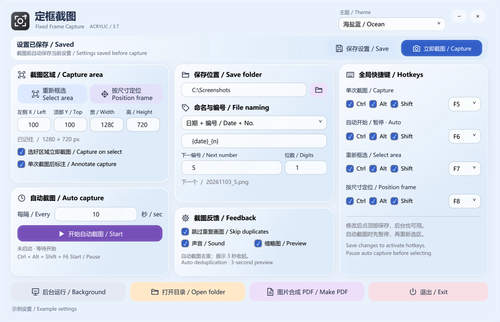
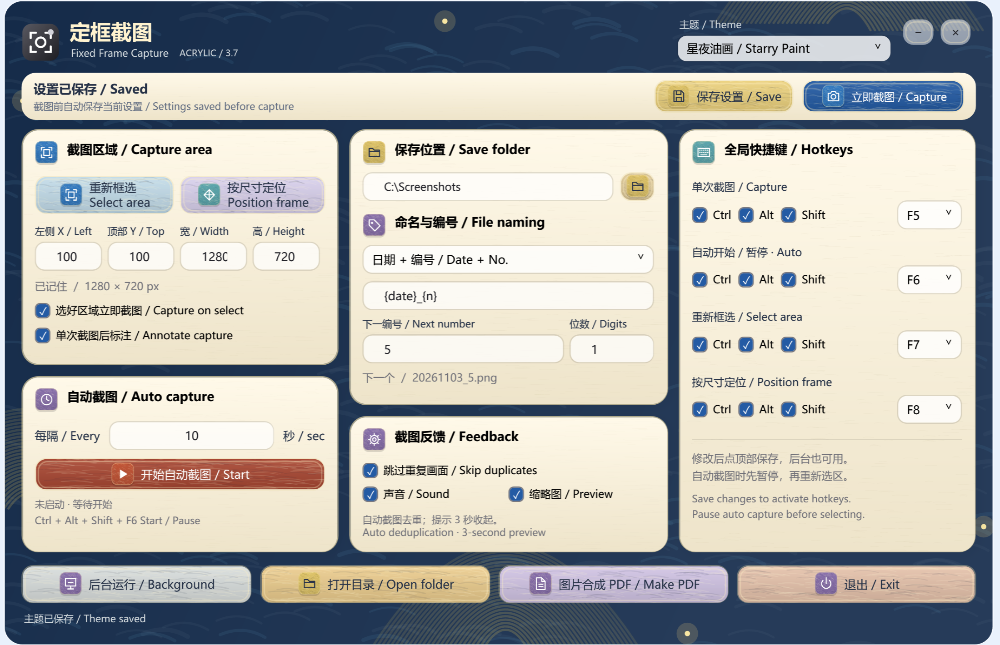
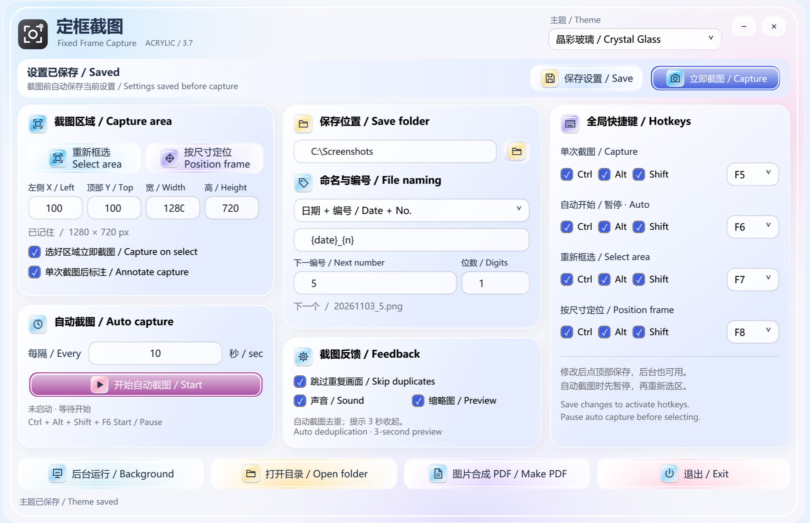
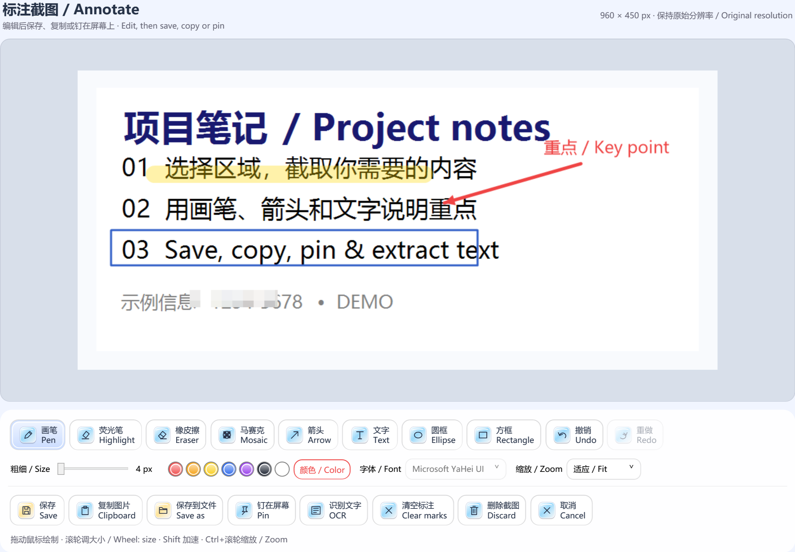

# 定框截图 · Fixed Frame Capture

**v3.7 · 窗口吸附、滚轮调节、完整首页与两套新皮肤**  
**v3.7 · Window snapping, wheel controls, a compact dashboard & two new skins**

Windows 固定区域截图工具：记住截图区域和保存设置，支持自动连续截图、编号命名、PDF 合成、单次标注和中英文文字识别。核心操作保留中英双语。

A portable Windows screenshot utility with remembered regions, automatic capture, sequential filenames, PDF export, an annotation editor and local Chinese/English OCR. Core controls are bilingual.

[下载 v3.7 / Download ZIP](https://github.com/369di-cmyk/fixed-frame-capture/releases/download/v3.7/FixedFrameCapture-v3.7-Windows.zip)

## 使用 / Getting started

解压后运行 `定框截图.exe`。升级前从托盘退出旧版本；新版会继续读取原来的区域、目录、编号、主题和原有快捷键。无需安装或登录。

Extract the ZIP and run `定框截图.exe`. Exit the older version from its tray menu before upgrading. Existing settings are reused. No installation or sign-in is required.

1. 点击“重新框选”，移动鼠标识别窗口，单击选中；也可以直接拖出选区，或输入宽高后“按尺寸定位”。选好后还可拖动边角微调，按 Enter 或双击选区确认。
2. 可选勾选“选好区域立即截一张”。确认选区才会截图，Esc 或右键取消不会截图。
3. “单次截图后标注”默认开启；关闭后单次截图恢复直接保存。
4. 选择目录、命名格式和下一编号。修改快捷键后点击顶部“保存设置”。
5. 单次截图使用顶部“立即截图”或快捷键；自动截图仍按间隔直接保存。

1. Use **Select area** to hover over a window and click to select it, or drag a custom region. **Position frame** uses your entered dimensions. Adjust the region, then press Enter or double-click inside it to confirm.
2. Enable **Capture after selection** to capture immediately after confirming the region. Cancelling selection does not capture anything.
3. **Annotate single capture** is on by default. Turn it off to save single captures directly.
4. Set the folder, naming pattern and next number. Click **Save settings** after editing hotkeys.
5. Use **Capture** or its hotkey for a single image. Timed capture saves images directly.

## v3.7 首页与皮肤 / Dashboard and skins

首页改为三栏，选区、自动截图、保存命名、截图反馈与四组快捷键同时显示。顶部始终显示保存状态和截图入口，不需要整页滚动。较小屏幕会按可用空间等比例缩小。

The three-column dashboard shows capture, scheduling, output, feedback and all four hotkeys together. Save status and capture actions remain at the top. Smaller screens scale the dashboard down without page scrolling.

新增两套参考风格：星夜油画采用深蓝金色背景、奶油色卡片和笔触按钮；晶彩玻璃采用珠光渐变、玻璃边缘与彩色图标。原有四套主题继续保留，切换后自动记住。

Two new skins: **Starry Paint** combines navy and gold, cream cards and painted buttons. **Crystal Glass** uses pearlescent gradients, glass edges and colorful icons. The original four themes remain available; theme selection is remembered.

示例图由新版实际界面以 2 倍分辨率渲染，内容为演示设置。皮肤使用程序绘制的材质与原有图标，不包含参考图片中的品牌标志。

These 2× renders use the actual application with example settings. Skin materials are drawn in code with the app's existing symbols; reference brand logos are not included.

## 窗口吸附和微调 / Window snapping and adjustment

- 移动鼠标时高亮可识别的应用窗口；单击选中后停留在微调状态。
- 拖动四角或四条边改变大小，拖动选区内部移动；方向键移动 1 像素，Shift + 方向键移动 10 像素。
- Enter、双击选区内部或“确认”按钮完成；R 重新选择，Esc 或右键取消。
- 手动拖选和按尺寸定位同样支持确认前微调。只有最终确认后，“选好区域立即截图”才会生效。
- 忽略透明鼠标辅助浮层、最小化窗口和桌面外壳。捕捉的是窗口边界；最终图片来自屏幕当前画面，不会还原被其他窗口遮挡的内容。

Hover to highlight an application window, then click to select it. Drag an edge/corner to resize or drag inside to move. Arrow keys move by 1 pixel; Shift + arrows move by 10. Enter, double-click inside, or Confirm completes the selection. R restarts; Esc or right-click cancels. Manual and fixed-size selection also allow adjustment before confirmation. Capture-on-select runs only after confirmation. Transparent cursor overlays and minimized/shell windows are ignored. Snapping selects a window's bounds; the image contains what is currently visible on screen, including any occlusion.

## 默认快捷键 / Default global hotkeys

| 操作 / Action | 默认 / Default |
| --- | --- |
| 单次截图 / Capture | Ctrl + Alt + S |
| 自动开始 / 暂停 · Start / pause auto | Ctrl + Alt + F9 |
| 重新框选 / Select area | Ctrl + Alt + A |
| 按尺寸定位 / Position frame | Ctrl + Alt + D |

四组均可自定义，在后台也可使用；已保存的个人设置优先。快捷键不能重复，被其他程序占用时会报错并尝试恢复原有四组快捷键。自动截图运行中请先暂停再调整选区；编辑器打开期间不启动新的截图任务。

All four are configurable and work in the background. Saved settings override defaults. Duplicate or occupied shortcuts are rejected; failed registration restores the previous shortcuts where possible. Pause automatic capture before changing the region. While the editor is open, new capture actions are blocked.

## 单次截图标注 / Annotation editor

上图由实际界面渲染，图片内容为演示样例。预览缩放不改变导出分辨率。

Rendered from the actual application using demonstration content. Zoom affects the preview only; export retains the original pixel dimensions.

- 画笔、荧光笔、箭头、文字、圆框和方框：可调粗细 / 字号与颜色。文字可选字体。
- 橡皮擦：调整大小，擦除标注以还原底图；不涂白，也不破坏截图底图。
- 马赛克：拖出矩形，调整色块大小；使用原图的块状颜色，不提供染色选项。建议使用较大色块并检查遮挡效果。
- 撤销 / 重做，清空标注（可撤销），取消或删除本次截图。

- Pen, highlighter, arrow, text, ellipse and rectangle with adjustable size and color; text supports font selection.
- Adjustable eraser removes annotation pixels and reveals the original screenshot.
- Drag a rectangular mosaic; block size is adjustable and colors come from the image. Inspect the result before sharing.
- Undo, redo, undoable clear, cancel and discard.

| 动作 / Action | 结果 / Result |
| --- | --- |
| 保存 / Save · Ctrl+S | 按设置目录和编号保存 PNG，关闭编辑器 / Save to configured folder and advance sequence |
| 复制图片 / Clipboard · Ctrl+C | 将完整图片放入剪贴板，关闭编辑器 / Copy full-resolution image and close |
| 保存到文件 / Save as · Ctrl+Shift+S | 选择 PNG 路径，不占用自动编号 / Choose a PNG path without consuming a sequence number |
| 钉在屏幕 / Pin | 置顶显示图片，关闭编辑器；不自动落盘 / Keep image on top without saving a file |
| 删除截图 / Discard；取消 / Esc | 丢弃本次未保存截图，不删除历史文件、不占编号 / Discard this unsaved capture only |

在图片预览区或粗细滑块上滚动鼠标滚轮，调整当前工具大小：每格 1，Shift + 滚轮每格 5；文字调整字号，马赛克调整块大小，其他工具调整线宽或橡皮擦大小。每种工具会记住本次编辑中的大小。Ctrl + 滚轮调整预览缩放，不改变导出分辨率。

Over the image viewport or size slider, the wheel changes the active tool size by 1; Shift + wheel changes it by 5. Text uses font size, mosaic uses block size, and other tools use stroke/eraser size. Each tool remembers its size during the current edit. Ctrl + wheel changes preview zoom only.

**Ctrl+Z** 撤销；**Ctrl+Y** 或 **Ctrl+Shift+Z** 重做。字号、线宽均按原图像素计，预览支持适应窗口和 50% / 100% / 150% / 200%。马赛克保存后为普通扁平 PNG，不带可撤销的图层。

Undo with **Ctrl+Z**, redo with **Ctrl+Y** or **Ctrl+Shift+Z**. Sizes use source-image pixels. Exports are flattened PNG images without editable annotation layers.

## 钉图 / Pinned images

拖动图片移动，滚轮缩放，双击图片关闭钉图（不删除已保存的文件）；右键可复制、保存到文件或关闭，Esc 关闭当前钉图。退出程序会关闭所有钉图。再次截图或选区时，程序先临时隐藏已有钉图，完成后恢复，避免把它们截进去。

Drag to move, wheel to resize, double-click the image to close the pin without deleting saved files. Right-click to copy, save or close; Esc closes the active pin. All pins close when the application exits. Pins are temporarily hidden during this application's captures and region selection.

## 中英文 OCR / Chinese & English OCR

在编辑器点击“识别文字 / OCR”。可选自动、简体中文、英语、繁体中文；自动优先简体中文，其次英语，再其次本机已有语言。结果可修改、复制、保存为 UTF-8 文本。

Click **OCR** in the editor. Choose Auto, Simplified Chinese, English or Traditional Chinese. Auto prefers Simplified Chinese, then English, then another installed recognizer. Results are editable and can be copied or saved as UTF-8 text.

使用 [Windows 自带 OCR](https://learn.microsoft.com/en-us/uwp/api/windows.media.ocr.ocrengine)，不向云端发送图片。需要 Windows 10 / 11、自带 Windows PowerShell 5.1 和相应 OCR 语言包；缺失时会显示提示。可到 Windows“时间和语言 → 语言和区域”检查语言支持。本机已实测简体中文、英文及中英混排；繁体入口存在，但本机未安装繁体 OCR 语言，未做准确率实测。

Uses the [built-in Windows OCR engine](https://learn.microsoft.com/en-us/uwp/api/windows.media.ocr.ocrengine); no cloud upload. Requires Windows 10/11, built-in Windows PowerShell 5.1 and the relevant OCR language pack. Missing support is reported. Simplified Chinese, English and mixed text were tested on this machine. Traditional Chinese requires its own installed recognizer and was not tested here.

识别时会临时生成本地图片并在结束后清理；大图仅在 OCR 时缩小到最长边 2500 像素，保存图片不缩小。识别受清晰度、字体和排版影响，请核对重要文字。OCR 负责提取文字，不翻译。

Temporary local files are cleaned up after recognition. OCR input is limited to a 2500-pixel longest edge, without changing saved images. Review important text; recognition quality depends on image clarity and layout. OCR extracts text; it does not translate.

## 保留功能 / Existing features

- 自动定时截图、快捷键开始 / 暂停、相邻重复画面跳过、可关闭的截图声音和 3 秒缩略图。
- `{n}` 连续编号，例如从 5 开始得到 5、6、7；`{date}` 日期、`{time}` 时间和补零位数；不会覆盖同名图片。
- 多张图片按顺序合成 PDF，支持调整顺序和页面布局；列表移除不会删除原图。
- 海盐蓝、薰衣草、蜜桃橙、经典黑白、星夜油画、晶彩玻璃六种主题；设置和单次截图按钮固定在顶部。

- Timed captures, global start/pause hotkey, exact duplicate skipping, shutter sound and a 3-second thumbnail.
- Sequential `{n}`, `{date}`, `{time}` and optional zero-padding. Existing filenames are skipped rather than overwritten.
- Ordered images-to-PDF with page layout choices; removing a list entry does not delete the source file.
- Ocean, Lavender, Peach, Classic, Starry Paint and Crystal Glass themes; pinned settings and capture controls.

自动去重只比较本轮最近一次保存的自动截图；任何像素变化都会保存。单次截图不去重。编辑器关闭前，不会先保存一份未标注原图。

Duplicate skipping compares the latest saved automatic frame in the current run. Single captures are never deduplicated. The editor does not save an unannotated copy before you choose an output action.

## 本地数据 / Local data

设置：`%LOCALAPPDATA%\FixedCapture\settings.json`。图片保存在选择的目录。源码、发布包和示例图不包含个人配置或实测桌面截图。`--profile <directory>` 可指定独立配置目录。

Settings use the path above. Images go to the selected folder. The package contains no personal settings or captured desktop test images. Use `--profile <directory>` for an isolated profile.

## 编译和测试 / Build and tests

在 Windows PowerShell 中运行 `build.ps1`，仓库源码默认输出 `FixedFrameCapture.exe`（发布 ZIP 内为 `定框截图.exe`）。使用系统自带 .NET Framework 编译器、WPF 和 WinForms，无需 NuGet。OCR 脚本嵌入可执行文件。

Run `build.ps1` in the repository on Windows to build `FixedFrameCapture.exe` (the release ZIP uses `定框截图.exe`). It uses the built-in .NET Framework compiler, WPF and WinForms, without NuGet dependencies. The OCR worker is embedded in the executable.

发布包中的 `tests\run.ps1` 编译并运行隔离回归；测试会抓取桌面左上角的小区域、临时打开界面并覆盖剪贴板为测试内容。不会使用正式设置文件；结果保存在传入的测试目录。OCR 测试要求已安装简体中文和英语。

The release package includes `tests\run.ps1`, which builds and runs the isolated regression. It captures a small top-left desktop region, opens test windows and replaces clipboard contents with test data. Production settings are not used. OCR tests require English and Simplified Chinese support.

已完成的验证见 `验证记录.txt`。多屏混合缩放组合、不同设备上的 OCR 识别率和所有粘贴目标程序尚未穷尽测试。

See `验证记录.txt` for validation evidence. Mixed-DPI multi-monitor setups, OCR accuracy on other devices, and all possible paste destinations have not been exhaustively tested.

