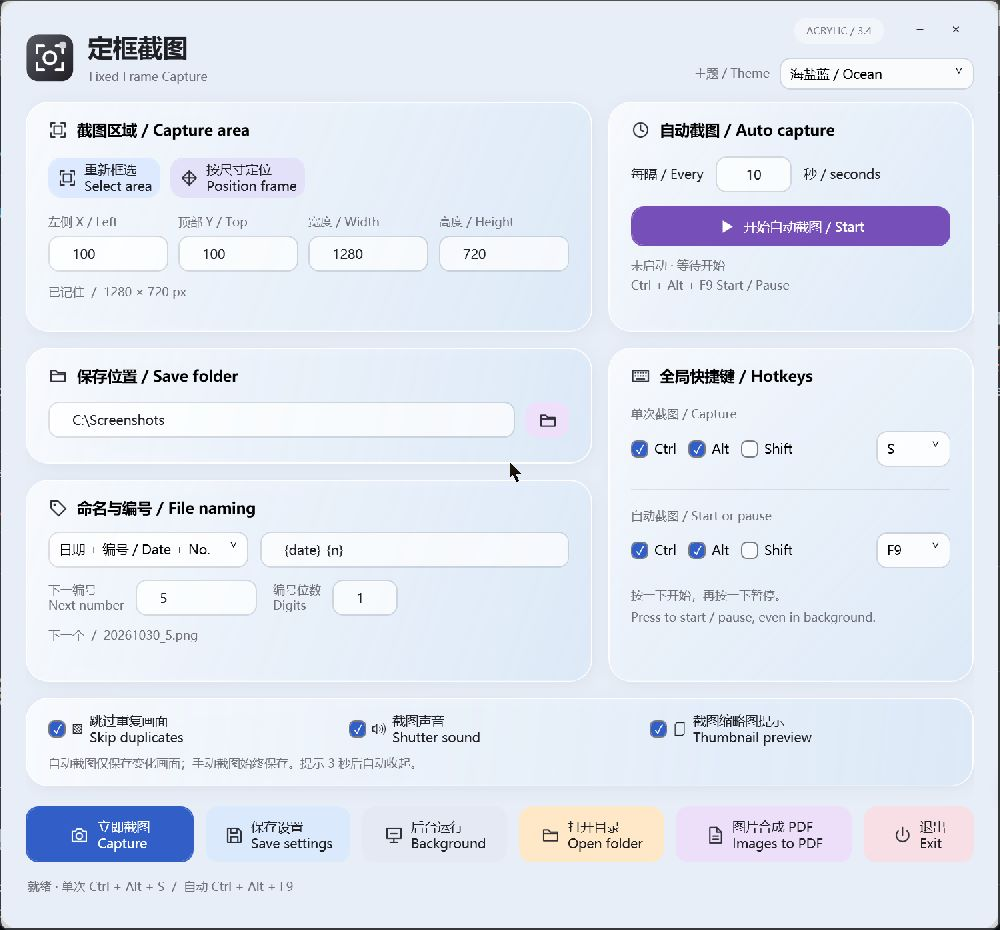
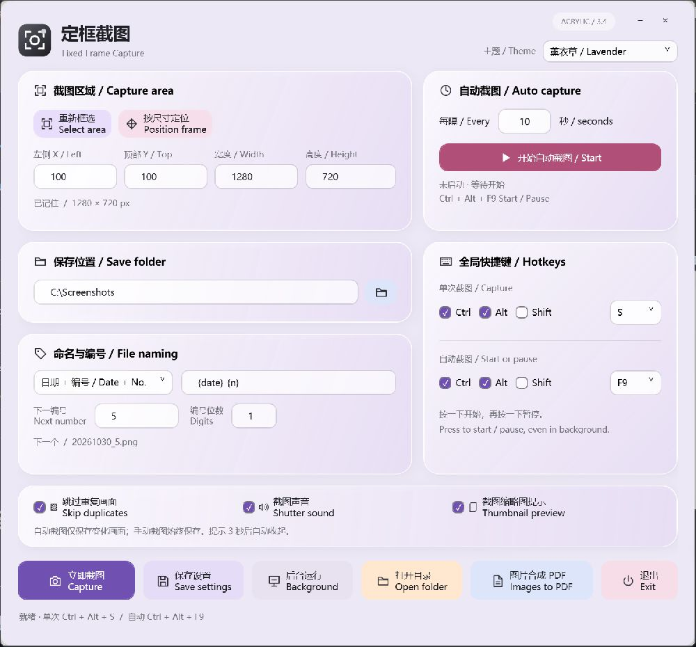
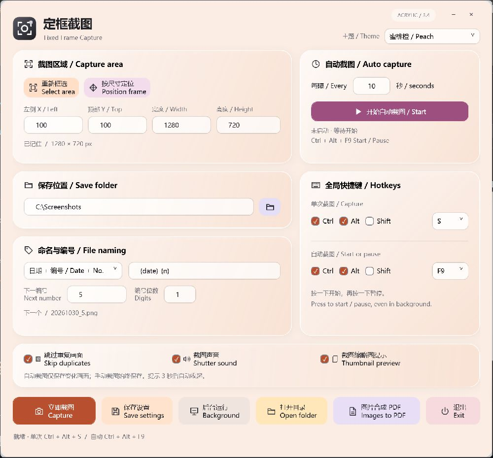
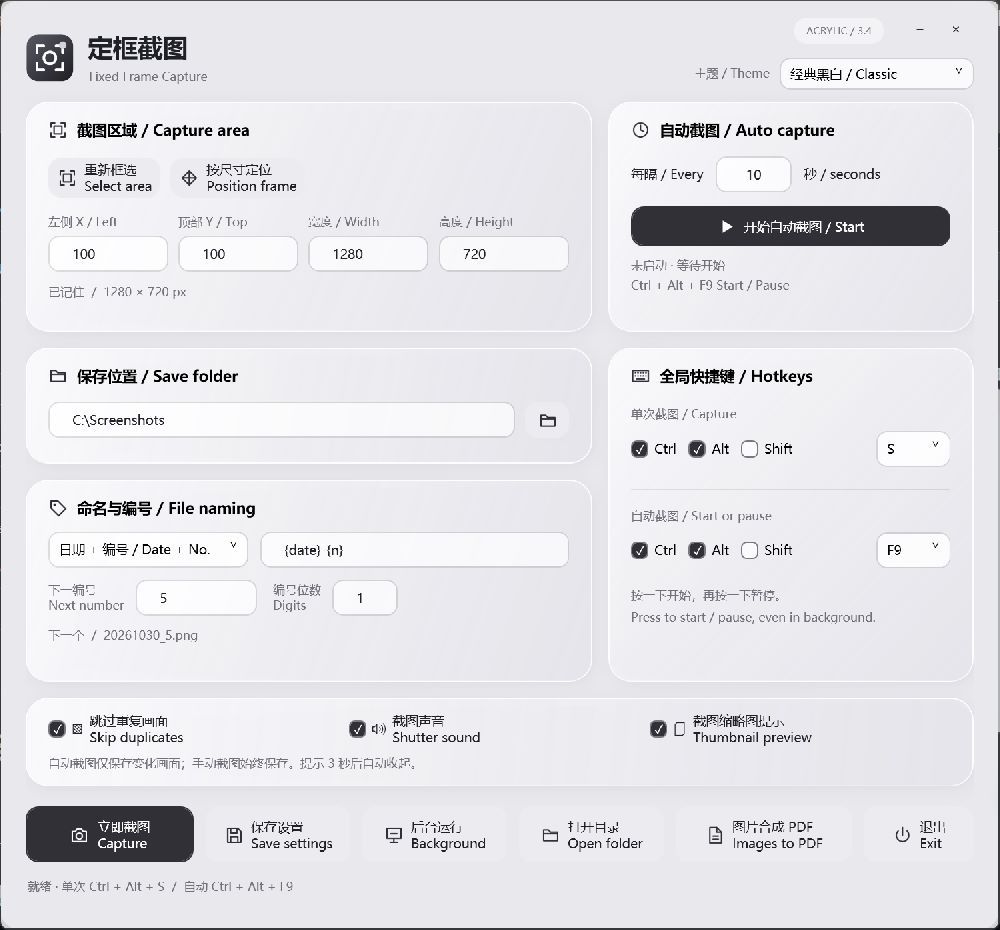

# 定框截图 · Fixed Frame Capture

A lightweight Windows screenshot utility with remembered capture regions, global hotkeys, automatic capture, sequential filenames, PDF export and colorful themes.

Windows 固定区域截图工具：设置一次区域，之后通过快捷键或定时自动截图，自动保存并连续编号。

**Version / 版本：3.4** · **UI / 界面：核心操作中英双语 / bilingual core controls**

## 界面预览 / Interface preview

**设置一次，随时截图。 / Set the region once, capture anytime.**



- **左上 / Top left**：截图区域、坐标与尺寸 / Capture region, coordinates and dimensions.
- **右上 / Top right**：定时间隔和开始/暂停 / Capture interval and start/pause.
- **中部 / Middle**：保存位置、文件名与全局快捷键 / Save folder, filenames and global hotkeys.
- **底部 / Bottom**：去重、声音、缩略图和 PDF 入口 / Duplicate skipping, sound, thumbnail and PDF tools.

### 四套主题 / Four themes

在右上角 **主题 / Theme** 中选择，主题会自动记住。点击图片可查看大图。

Choose **Theme** in the top-right corner; your choice is remembered. Click an image to view it full-size.

| 海盐蓝 / Ocean | 薰衣草 / Lavender |
|:---:|:---:|
|  |  |
| **蜜桃橙 / Peach** | **经典黑白 / Classic** |
|  |  |

*以上为 v3.4 实际窗口截图，使用演示配置。毛玻璃效果可能因 Windows 版本和桌面背景而异。*

*Actual v3.4 window screenshots with demonstration settings. Acrylic appearance may vary with Windows version and desktop background.*

## 下载与运行 / Download & run

**[下载 Windows 压缩包 / Download Windows ZIP](https://github.com/369di-cmyk/fixed-frame-capture/releases/download/v3.4/FixedFrameCapture-v3.4-Windows.zip)** · [v3.4 Release](https://github.com/369di-cmyk/fixed-frame-capture/releases/tag/v3.4)

Download [FixedFrameCapture.exe](https://github.com/369di-cmyk/fixed-frame-capture/raw/refs/heads/main/FixedFrameCapture.exe) using the download button on its file page. Run it on Windows; no installer is required. Exit any older version before starting this one.

点击 [FixedFrameCapture.exe](https://github.com/369di-cmyk/fixed-frame-capture/raw/refs/heads/main/FixedFrameCapture.exe) 下载程序，双击运行，无需安装。更新前请先从托盘退出旧版。

Requires Windows with .NET Framework 4.5 or later and WPF. Tested locally on Windows 11; acrylic effects depend on Windows support and fall back to a solid frosted appearance. The executable is not code-signed.

需要支持 WPF 的 .NET Framework 4.5 或更新版本。本机已在 Windows 11 上检查启动；毛玻璃效果取决于系统支持，不支持时使用实色磨砂外观。程序未进行代码签名。

## 功能 / Features

| 中文 | English |
|---|---|
| 记住截图区域，支持重新框选、坐标和尺寸设置 | Remembered region, drag selection, coordinates and dimensions |
| 自定义全局截图快捷键 | Custom global capture hotkey |
| 每隔指定秒数自动截图，独立快捷键开始/暂停 | Interval capture with a separate start/pause hotkey |
| 自动保存到指定目录 | Save automatically to a chosen folder |
| 日期、时间、自定义前缀和连续编号 | Date, time, custom prefixes and sequential numbering |
| 跳过完全相同的自动截图 | Skip pixel-identical automatic captures |
| 可关闭的快门声和左下角缩略图 | Optional shutter sound and corner thumbnail preview |
| 多张图片合成 PDF，排序、调整顺序、原图比例或 A4 | Images to PDF, ordering, original ratio or A4 pages |
| 海盐蓝、薰衣草、蜜桃橙、经典黑白主题 | Ocean, Lavender, Peach and Classic themes |
| 托盘后台运行 | System tray operation |

## 快速开始 / Quick start

1. **重新框选 / Select area**：拖动选择截图区域，或输入 X、Y、宽度和高度。
2. **保存位置 / Save folder**：选择截图保存目录。
3. **命名与编号 / File naming**：设置命名方式、下一编号和补零位数。
4. **全局快捷键 / Hotkeys**：设置单次截图以及自动截图开始/暂停快捷键，再点 **保存设置 / Save settings**。
5. 点击 **立即截图 / Capture**，或开启 **自动截图 / Auto capture**。关闭主窗口会继续在托盘运行；选择 **退出 / Exit** 才会退出程序。

**English steps**

1. Select a capture region, or enter its position and dimensions.
2. Choose a destination folder and naming pattern.
3. Configure the next number and optional zero-padding.
4. Configure both hotkeys and click **Save settings**.
5. Use **Capture** for one image, or **Auto capture** for timed captures. Closing the main window keeps the app in the tray; **Exit** quits it.

Defaults: **Ctrl + Alt + S** captures once; **Ctrl + Alt + F9** starts/pauses auto capture. Existing settings override these defaults.

默认快捷键：**Ctrl + Alt + S** 单次截图，**Ctrl + Alt + F9** 开始/暂停自动截图。已有设置优先。

### 命名示例 / Naming examples

- `{n}` with next number `5` → `5.png`, `6.png`, `7.png`.
- `{date}_{n}` → `20261030_5.png`, `20261030_6.png`.
- `Notes_{date}_{time}_{n}` adds a custom prefix and timestamp.
- `{n}` is required. Existing files are not overwritten; occupied numbers are skipped.

`{n}` 为必需编号；`{date}` 为日期，`{time}` 为时间。已有同名文件不会被覆盖。

### 去重与提示 / Duplicates & feedback

Duplicate skipping applies only to automatic capture and compares against the last saved automatic frame in the current session. Any pixel change saves a new image. Manual captures always save; restarting auto capture resets the baseline. Skipped frames do not consume sequence numbers or trigger sound/preview.

去重仅针对本轮自动截图中的相邻已保存画面，任何像素变化都会保存；手动截图始终保存，重新开始自动截图会重置比较基准。跳过不占编号、不响铃、不弹提示。

The thumbnail dismisses after 3 seconds and is hidden before the next capture, followed by a short delay. Click it to open the image. Sound and preview can be disabled separately.

缩略图 3 秒后自动收起；下一次截图前会先隐藏并稍作等待，点击可打开图片。声音、缩略图可独立关闭。

### PDF

Open **Images to PDF**, add images, adjust their order, choose the page layout, then **Export PDF**. Removing an entry from the list does not delete the original image. Opening the PDF dialog pauses automatic capture.

打开“图片合成 PDF”，添加图片、调整顺序和页面排版后导出。列表中的“移除”不会删除原图片。打开 PDF 窗口会暂停自动截图。

## 本地数据 / Local data

Images are saved to the chosen folder. Settings are stored in `%LOCALAPPDATA%\FixedCapture\settings.json`. The app does not implement cloud uploads. This repository does not include personal settings or test screenshots.

图片保存在所选目录，设置保存在上述本地位置。程序不包含云上传功能，仓库不含个人配置或测试截图。

## 从源码编译 / Build from source

The C# and XAML sources are in the repository root. On Windows, run:

```powershell
.\build.ps1
```

The script uses the Windows .NET Framework C# compiler and produces `FixedFrameCapture.exe`. No NuGet packages are required.

源码位于仓库根目录，编译脚本调用 Windows 自带的 .NET Framework 编译器，无需 NuGet 依赖。

## 验证范围 / Validation status

Compilation, startup, core filename/persistence/image tests, duplicate fingerprint tests and selected theme layouts have been checked locally. Full end-to-end interaction coverage is incomplete: browser/desktop automation could not activate the application for some hotkey, preview, PDF and theme-dropdown checks. Please report reproducible issues with Windows version and steps.

已完成编译、启动、命名与配置/图片核心测试、重复画面指纹测试及部分主题布局检查。端到端交互验证尚不完整：桌面自动化无法激活窗口，部分快捷键、缩略图、PDF、主题下拉操作尚未完成自动实测。反馈问题时请附 Windows 版本和复现步骤。

